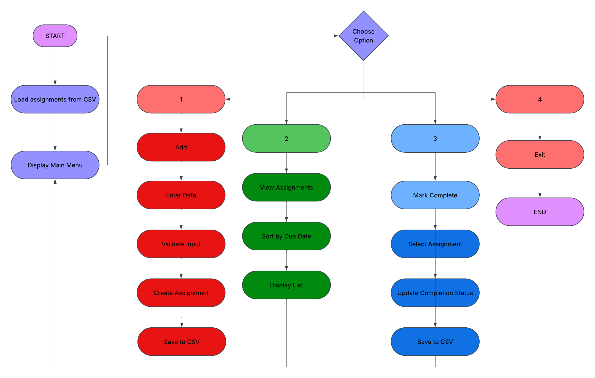

# Assignment Deadline Tracker

A Java command-line application that helps students organize assignments, track deadlines, and monitor completion status across multiple courses.

## The Problem

Students often have assignments spread across multiple classes, making it difficult to keep track of upcoming deadlines and completed work. This project aims to provide a simple, centralized tool where students can record assignments, see which deadlines are approaching, and track their progress without needing a complicated application.

## How It Works

The Assignment Deadline Tracker is a terminal-based Java application with an interactive menu.

When the program starts, it loads previously saved assignments from a CSV file. Users can then choose to add new assignments, view assignments sorted by due date, mark assignments as completed, or exit the program.

Each assignment contains:
- Course name
- Assignment name
- Due date
- Completion status

Whenever an assignment is added or marked complete, the program saves the updated information to a CSV file. This allows assignments and their completion statuses to remain available after the application closes.

### System Diagram



The diagram illustrates how the main menu interacts with assignment creation, viewing, completion tracking, and CSV file storage.

The editable diagram source is also available at `docs/system-diagram.drawio`.

## Tech Stack

| Component | Technology |
|---|---|
| Programming language | Java (JDK 11 or newer) |
| User interface | Command-line interface (CLI) |
| User input | `java.util.Scanner` |
| Assignment storage in memory | `java.util.ArrayList` |
| Date handling | `java.time.LocalDate` |
| Sorting | `java.util.Comparator` |
| File operations | `java.nio.file.Files`, `Path`, `Paths` |
| Persistent storage | CSV (`data/assignments.csv`) |
| Development environment | Visual Studio Code |
| Version control | Git and GitHub |
| External libraries | None |
| External APIs | None |

## Installation and Setup

### Prerequisites

Before running the application, install:

1. **Java Development Kit (JDK) 11 or newer**
2. **Git** to clone the repository
3. A terminal, such as PowerShell, Command Prompt, or the VS Code integrated terminal

Verify Java and Git are installed:

```bash
java -version
javac -version
git --version
```

### Step 1: Clone the Repository

Open a terminal and enter:

```bash
git clone https://github.com/nealshrimali/assignment-deadline-tracker.git
```

### Step 2: Navigate to the Project Directory

```bash
cd assignment-deadline-tracker
```

### Step 3: Compile the Java Files

```bash
javac -d out src/Assignment.java src/Main.java
```

This compiles the Java source files into the `out` directory.

### Step 4: Run the Application

```bash
java -cp out Main
```

The program will load any previously saved assignments and display the main menu.

No external packages or API keys are needed.

## Example Usage

### Main Menu

When the program launches, the following menu appears:

```text
=== Assignment Deadline Tracker ===
1. Add Assignment
2. View Assignments
3. Mark Assignment Complete
4. Exit
Choose an option (1-4):
```

### Example 1: Adding an Assignment

**User input:**

```text
Choose an option (1-4): 1
Enter course name: CS193
Enter assignment name: Final Project
Enter due date (YYYY-MM-DD): 2026-12-15
```

**Program output:**

```text
Assignments saved successfully.
Assignment added successfully!
```

### Example 2: Viewing Assignments

After adding 2 assignments, select option `2`.

```text
Choose an option (1-4): 2

=== Your Assignments (Sorted by Due Date) ===

Assignment #2
Course: MA261
Assignment: Homework 10
Due Date: 2026-12-01
Status: Incomplete

Assignment #1
Course: CS193
Assignment: Final Project
Due Date: 2026-12-15
Status: Incomplete
```

Assignments are displayed from earliest to latest due date.

Assignment numbers refer to their original positions in the stored list, so the completion feature remains consistent with the sorted display.

### Example 3: Marking an Assignment Complete

**User input:**

```text
Choose an option (1-4): 3

=== Mark Assignment Complete ===
1. Final Project (CS193) - Incomplete
2. Homework 10 (MA261) - Incomplete

Enter assignment number to complete: 2
```

**Program output:**

```text
Assignments saved successfully.
Assignment marked as completed!
```

When the user views assignments again, Homework 10 will display `Status: Completed`.

### Example 4: Persistent Storage

Assignments are saved to `data/assignments.csv`.

Example file contents:

```csv
course,assignment,dueDate,completed
CS193,Final Project,2026-12-15,false
MA261,Homework 10,2026-12-01,true
```

When the program is restarted, the saved assignments and their completion statuses are automatically restored.

## Project Roadmap

### MVP - Version 1.0

- [x] Create GitHub repository and initialize project structure
- [x] Write project README and initial documentation
- [x] Complete Eisenhower Matrix and system diagram
- [x] Create the `Assignment` class
- [x] Build the interactive command-line menu
- [x] Implement assignment creation
- [x] Implement assignment viewing
- [x] Implement assignment completion tracking
- [x] Add input validation for assignment names and dates
- [x] Implement CSV file saving
- [x] Implement CSV file loading
- [x] Test assignment persistence between program sessions
- [x] Document test cases and results

### Additional Feature - Version 1.1

- [x] Sort assignments by due date, earliest first

### Future Improvements - Version 2.0+

- [ ] Add sorting by course
- [ ] Display assignments due within the next 7 days
- [ ] Add assignment priority levels (High, Medium, Low)
- [ ] Allow users to edit or delete assignments
- [ ] Improve CSV validation and error handling

## Testing

The application has been tested for the following scenarios:

- Adding valid assignments
- Rejecting empty course or assignment names
- Rejecting assignment names containing commas
- Handling invalid due-date formats
- Displaying multiple assignments
- Marking assignments as completed
- Rejecting invalid assignment numbers
- Handling invalid main menu choices
- Saving and loading assignments using CSV
- Preserving completion status after restarting the program
- Sorting assignments chronologically

Additional testing documentation is available in [`docs/testing.md`](docs/testing.md).

## Current Limitations

- Assignments cannot currently be edited or deleted.
- Sorting is available by due date but not by course.
- Course and assignment names cannot contain commas because of the simple CSV format.
- The program does not send automatic deadline notifications.
- The application runs in the terminal and does not have a graphical interface.
- Data is saved locally rather than synchronized across devices.

## Demo

**Video Walkthrough (3–4 minutes):**

[Watch the Assignment Deadline Tracker Demo](https://drive.google.com/file/d/13Lnri9JSTi32BXZ0TqudfMCuU2LeWuG3/view?usp=sharing)

The walkthrough demonstrates assignment creation, chronological sorting, completion tracking, CSV persistence, and the overall program structure.